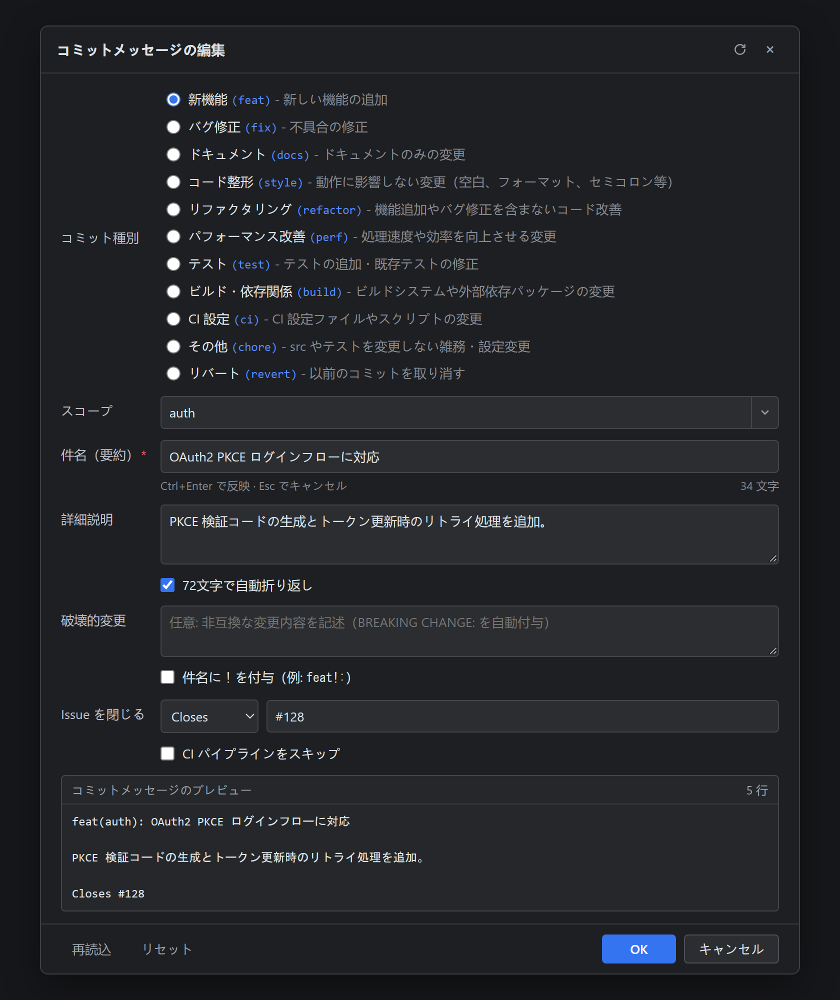

# Git Commit Template for OpenIDEA

[English](README.md) | [简体中文](README.zh-CN.md) | [繁體中文](README.zh-TW.md) | **日本語**

**OpenIDEA（`v0.1.53+`、Plugin API `^1.16`）** 向けのビジュアル **Conventional Commits** テンプレートプラグインです。

Git コミットパネルのツールバーからワンクリックで画面中央に**カード形式の入力フォーム**を表示し、**OK**（または `Ctrl+Enter` / `Cmd+Enter`）でコミット欄へ反映して**自動的にフォームを閉じます**。

## 主な機能

- **中央カード型フォーム & 自動クローズ**：
  - ツールバーアイコンまたは `Ctrl+Alt+Shift+C`（macOS: `Cmd+Alt+Shift+C`）で起動。
  - **OK / `Ctrl+Enter`** でコミットメッセージ欄へ書き込み後、自動でタブを閉じます。**キャンセル / `×` / `Esc`** で変更せずに閉じます。
- **Conventional Commits 完全対応**：
  - 11 種類の標準コミット種別、直近 20 件のスコープ履歴、件名バリデーション、72 文字自動折り返し（日本語・英語対応）、`BREAKING CHANGE:` と `!` マーカー、`Closes / Fixes / Resolves`、`[skip ci]`、既存メッセージからの双方向パースに対応。
- **コミット前フォーマット検査（`commitChecks`）**：
  - Commit Options の Before Commit で **Conventional Commits 形式チェック**を有効化可能（`Merge` / `Revert` 等は自動除外）。
- **11 言語の国際化（i18n）対応**：
  - OpenIDEA の表示言語に合わせてメニュー・フォーム・エラーメッセージを自動切替。

## 権限（Capabilities）について

本プラグインは WebAssembly サンドボックス内で動作し、ネットワーク・外部プロセス・プロジェクトファイルへのアクセスを行いません。
- `vcs.read` / `vcs.write`：コミット下書きの読み取りと反映に使用します。
- `storage`：スコープ履歴と設定の保存に使用します。
- `ide.commands`：OK / キャンセル押下時にフォームタブを自動で閉じるため、`toolwindow.focusEditor` と `editor.closeTab` の呼び出し**のみ**に使用します。

## ライセンス

[MIT License](LICENSE)
