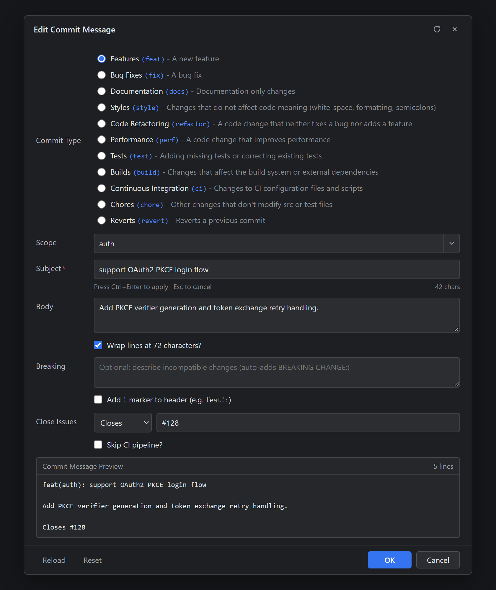
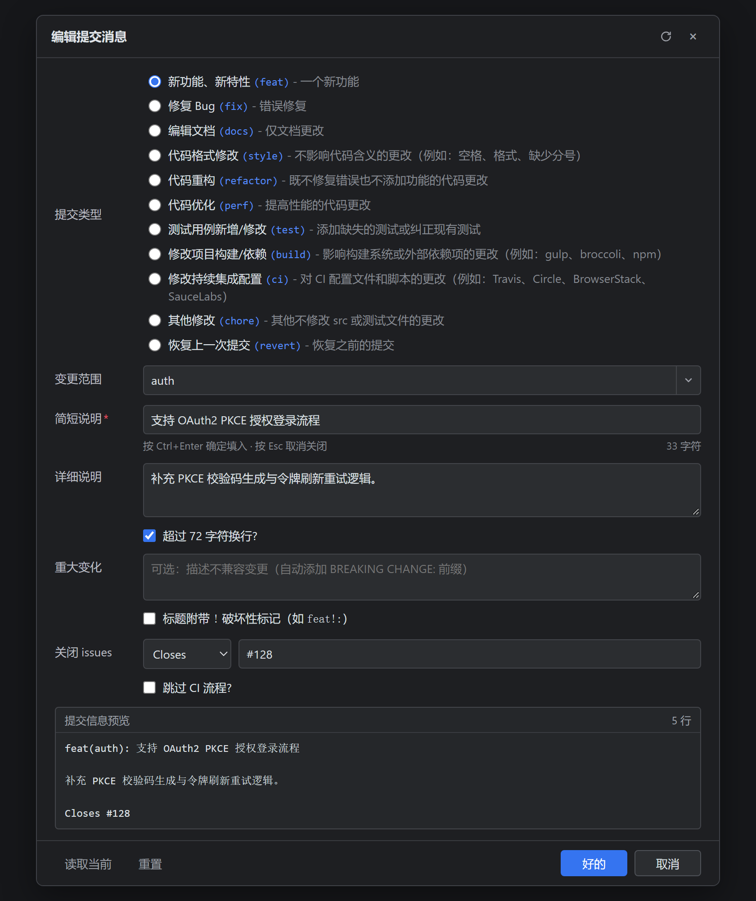
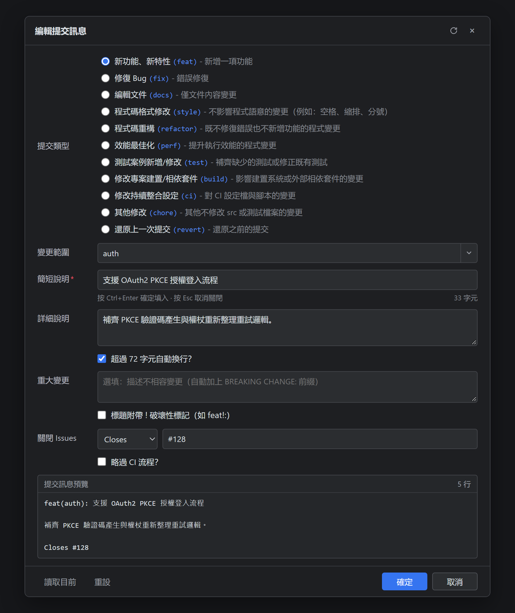
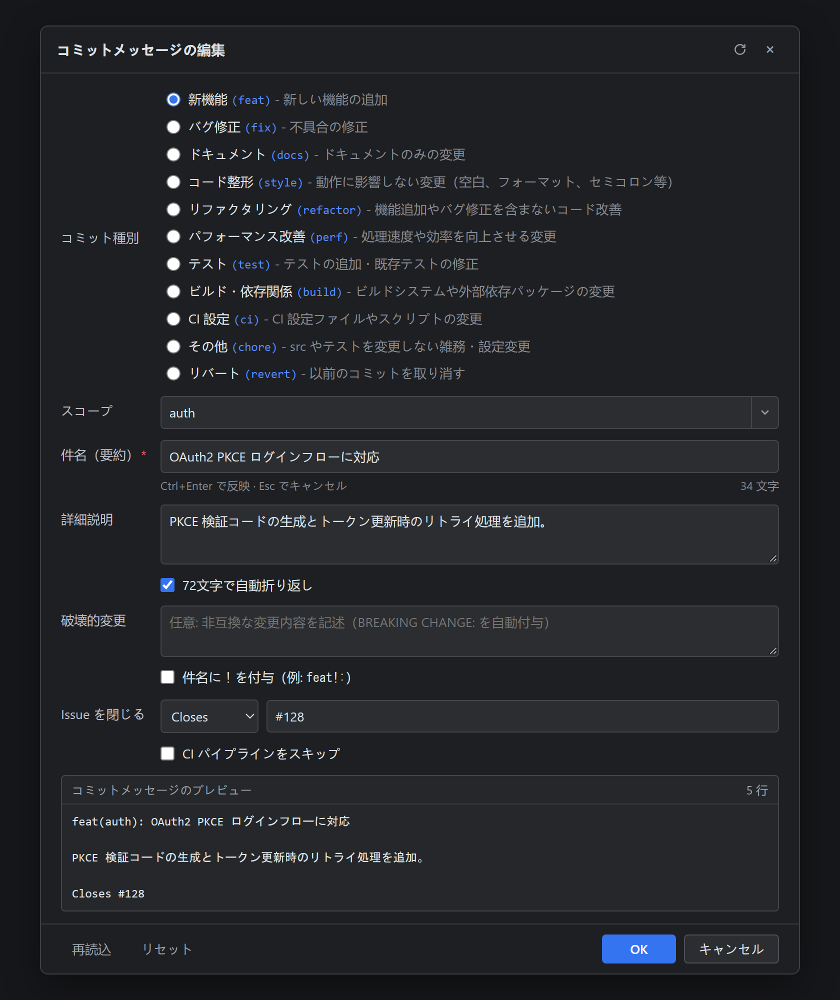
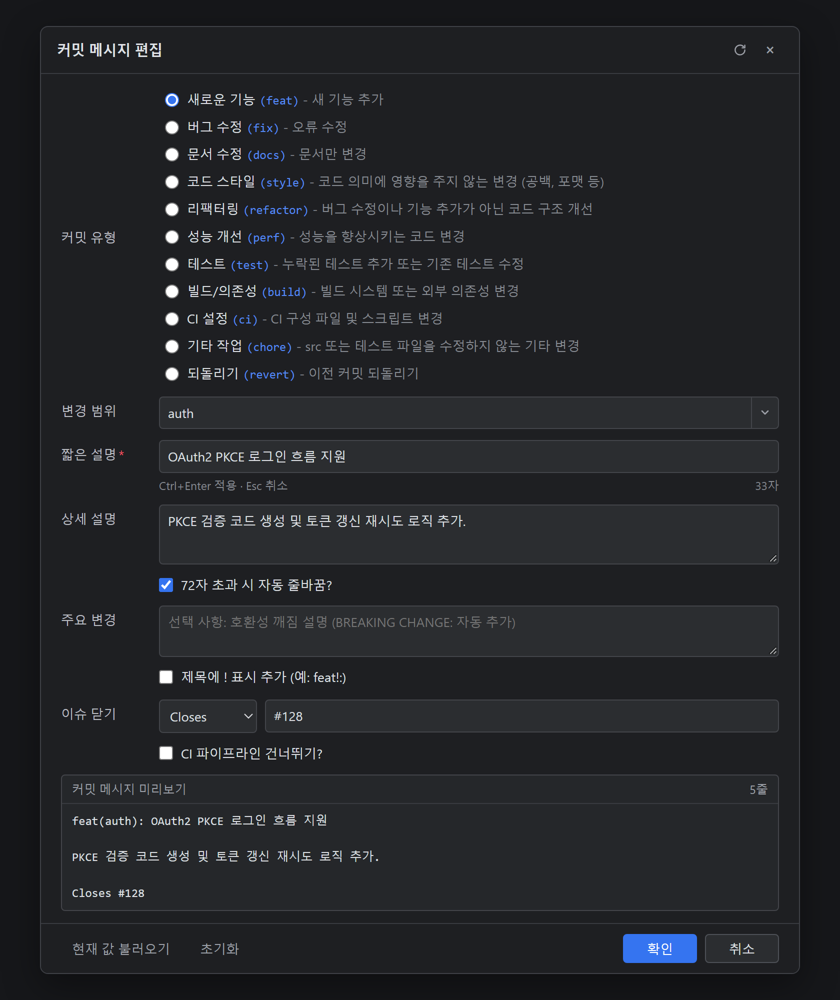

# Git Commit Template for OpenIDEA

**English** | [简体中文](README.zh-CN.md) | [繁體中文](README.zh-TW.md) | [日本語](README.ja.md)

A visual **Conventional Commits** template plugin for **OpenIDEA** (`v0.1.53+`, Plugin API `^1.16`).

Mounted directly on the Git Commit toolbar, clicking the icon opens a centered, dialog-style commit form in the main editor area — fill in your structured commit message, press **OK** (or `Ctrl+Enter` / `Cmd+Enter`), and the plugin writes the formatted message into the Commit input box and **automatically closes the form**.



<details>
<summary>More localized screenshots (简体中文 / 繁體中文 / 日本語 / 한국어)</summary>

| 简体中文 (`zh-CN`) | 繁體中文 (`zh-TW`) |
| --- | --- |
|  |  |

| 日本語 (`ja`) | 한국어 (`ko`) |
| --- | --- |
|  |  |

</details>

## Features

- **Centered Dialog-Card Form with Auto-Close**:
  - Click the Commit toolbar icon or press `Ctrl+Alt+Shift+C` (`Cmd+Alt+Shift+C` on macOS) to open a clean, centered form card.
  - **OK / `Ctrl+Enter`**: Validates and populates the Commit message box, then automatically closes the form tab.
  - **Cancel / `×` / `Esc`**: Closes the form tab immediately without modifying your existing commit draft.
- **Complete Conventional Commits Support**:
  - **Commit Types**: `feat`, `fix`, `docs`, `style`, `refactor`, `perf`, `test`, `build`, `ci`, `chore`, `revert`.
  - **Scope History**: Free-text input + dropdown history remembering your 20 most recent scopes (with per-item removal).
  - **Subject Validation & Length Counter**: Prevents accidental empty subjects and highlights headers exceeding 72 characters.
  - **72-Character Body Wrapping**: Word-aware wrapping for Latin scripts and clean character-boundary wrapping for CJK text.
  - **Breaking Changes**: Supports both `BREAKING CHANGE:` footer blocks and header `!` markers (e.g., `feat(api)!:`).
  - **Issue References**: Supports `Closes`, `Fixes`, and `Resolves` keywords (e.g., `128` → `Closes #128`) without corrupting normal English body paragraphs starting with words like *"Fix ..."* or *"Close ..."*.
  - **Skip CI**: Appends `[skip ci]` with a single checkbox.
  - **Two-Way Sync**: Automatically parses the current Commit box draft back into form fields for effortless re-editing.
- **Before-Commit Check (`commitChecks`)**:
  - Optional **Conventional Commits Format** check in *Commit Options → Before Commit* that catches malformed headers while automatically allowing `Merge`, `Revert`, `fixup!`, and `squash!` commits.
- **Full Internationalization (11 Languages)**:
  - Automatically follows OpenIDEA's UI language (`en`, `zh-CN`, `zh-TW`, `ja`, `ko`, `fr`, `es-MX`, `pt-BR`, `pl`, `tr-TR`, `ru`) across manifest menus, form UI, validation hints, and commit checks.

## Permissions & Capabilities Justification

In accordance with OpenIDEA's security model, this plugin runs in a sandboxed WebAssembly component with **no network, process, or project-file access**. It requests only the following capabilities:

| Capability | Risk Level | Why It Is Needed |
| --- | --- | --- |
| `vcs.read` | Low | Reads the current pending commit draft (`host::pending_commit`) to pre-fill the form and run the optional before-commit format check. |
| `vcs.write` | Low | Writes the formatted Conventional Commits message back into the Commit input box (`host::set_commit_message`). |
| `storage` | Low | Persists up to 20 recent scopes and your preferred default type / 72-char wrap toggle in plugin-local storage. |
| `ide.commands` | High | Invokes **only** `toolwindow.focusEditor` and `editor.closeTab` so the centered custom-editor form tab closes itself automatically when you click **OK**, **Cancel**, or press `Esc` (since `openidea:plugin/views` does not yet expose a dedicated `close` API). No external commands, VCS pushes, or shell actions are ever executed. |

## Installation

### From `.oiplugin` Package

1. Download the `.oiplugin` package from [Releases](https://github.com/chongchong59699/openidea-git-commit-template/releases) or GitHub Actions artifacts.
2. Open OpenIDEA and navigate to **Settings → Plugins**.
3. Click the gear icon (`⚙`) → **Install Plugin from Disk…** and select the `.oiplugin` file.
4. Approve the capabilities listed above and reload when prompted.

### Development Mode (`openidea-plugin link`)

```bash
openidea-plugin build .
openidea-plugin link .
```

## Building & Testing from Source

```bash
# Run unit tests against OpenIDEA's official MockHost
cargo test

# Build wasm32-wasip2 component and run manifest/component verification
openidea-plugin build .
openidea-plugin pack .
```

## License

Released under the [MIT License](LICENSE).
