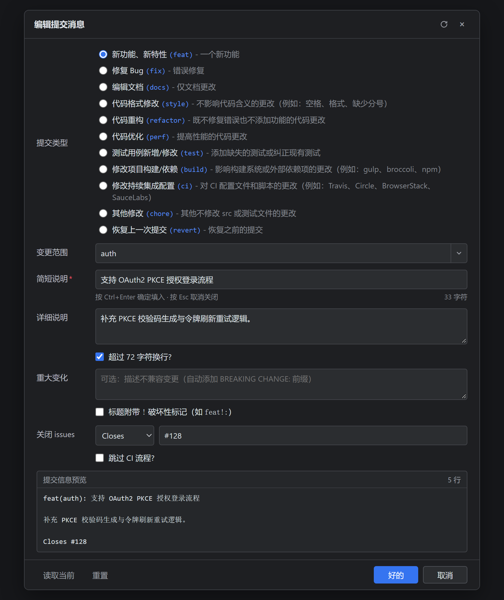

# Git Commit Template for OpenIDEA

[English](README.md) | **简体中文** | [繁體中文](README.zh-TW.md) | [日本語](README.ja.md)

面向 **OpenIDEA（`v0.1.53+`，Plugin API `^1.16`）** 的可视化 **Conventional Commits** 提交信息模板插件。

挂载在 Git 提交（Commit）面板输入框上方工具栏中，点击图标即可在主编辑区居中弹出**完整卡片式大表单**；填写完毕后点击 **【好的】**（或按 `Ctrl+Enter` / `Cmd+Enter`），即可一键写入 Commit 输入框并**自动关闭表单页**。



## 功能特性

- **屏幕居中卡片大表单 + 自动关闭**：
  - 点击 Commit 工具栏图标，或按下快捷键 `Ctrl+Alt+Shift+C`（macOS：`Cmd+Alt+Shift+C`）直接唤起完整表单。
  - **【好的】 / `Ctrl+Enter`**：校验并写入 Git 提交消息输入框，随后**自动关闭表单页**。
  - **【取消】 / 右上角 `×` / `Esc`**：不修改原有提交草稿，**立即自动关闭表单页**。
- **完整的 Conventional Commits 规范支持**：
  - **提交类型**：内置 11 项经典单选列表（`feat` / `fix` / `docs` / `style` / `refactor` / `perf` / `test` / `build` / `ci` / `chore` / `revert`）。
  - **变更范围记忆**：支持自由输入与下拉历史选择，自动记住最近 20 条常用 Scope（支持单条删除）。
  - **简短说明校验与字数提醒**：防止误提交空标题，并在标题超过 72 字符时高亮提醒。
  - **72 字符自动换行**：英文按单词边界换行，中文按字符宽度干净折行。
  - **重大变化（Breaking Changes）**：支持自动添加 `BREAKING CHANGE:` 页脚前缀，以及勾选标题 `!` 标记（如 `feat(api)!:`）。
  - **关联 Issues**：支持切换 `Closes` / `Fixes` / `Resolves` 关键字（输入 `128` 自动生成 `Closes #128`），且严格校验词元，不会误伤正文中以 `Fix` / `Close` 开头的普通句子。
  - **跳过 CI**：一键附加 `[skip ci]`。
  - **双向回填同步**：打开时自动解析当前 Commit 输入框已有内容，预览统一由 Rust 后端实时生成。
- **提交前规范检查（`commitChecks`）**：
  - 可在 Commit 选项（Before Commit）中启用 **Conventional Commits 规范检查**，自动拦截空提交或不规范标题，并放行 `Merge` / `Revert` / `fixup!` / `squash!` 等 Git 自动生成消息。
- **11 国语言国际化支持**：
  - 自动跟随 OpenIDEA 界面语言切换菜单、表单文案、占位符与校验提示（支持简体中文、繁体中文、英语、日语、韩语、法语、西班牙语、葡萄牙语、波兰语、土耳其语、俄语）。

## 权限与安全说明

本插件运行在 OpenIDEA 的 WebAssembly 沙箱中，**不申请任何网络、外部进程或项目文件读写权限**。所声明的权限及用途如下：

| 权限名称 | 风险等级 | 具体用途说明 |
| --- | --- | --- |
| `vcs.read` | 低 | 读取当前待提交草稿（`host::pending_commit`），用于自动回填表单及执行可选的提交前格式检查。 |
| `vcs.write` | 低 | 将生成的规范提交信息写入 Commit 输入框（`host::set_commit_message`）。 |
| `storage` | 低 | 在插件本地键值存储中保存最近使用的 20 条 Scope、上次选择的提交类型与换行偏好。 |
| `ide.commands` | 高 | **仅用于**在点击【好的】、【取消】或按 `Esc` 时调用 `toolwindow.focusEditor` 与 `editor.closeTab` 自动关闭表单标签页（因当前 `openidea:plugin/views` 尚未提供独立的关闭视图接口）。插件绝不调用任何提交推送、终端或外部命令。 |

## 安装方法

1. 从 [Releases](https://github.com/chongchong59699/openidea-git-commit-template/releases) 或 GitHub Actions 构建产物中下载 `.oiplugin` 插件包。
2. 打开 OpenIDEA，进入 **设置（Settings）→ 插件（Plugins）**。
3. 点击右上角齿轮图标（`⚙`）→ **从磁盘安装插件…（Install Plugin from Disk…）**，选择 `.oiplugin` 文件。
4. 确认授权上述权限并重载即可在 Git 提交面板工具栏看到图标。

## 源码构建与测试

```bash
# 运行单元测试（基于官方 MockHost）
cargo test

# 编译 WASM 组件并执行清单与接口校验
openidea-plugin build .
openidea-plugin pack .
```

## 开源协议

基于 [MIT License](LICENSE) 开源。
