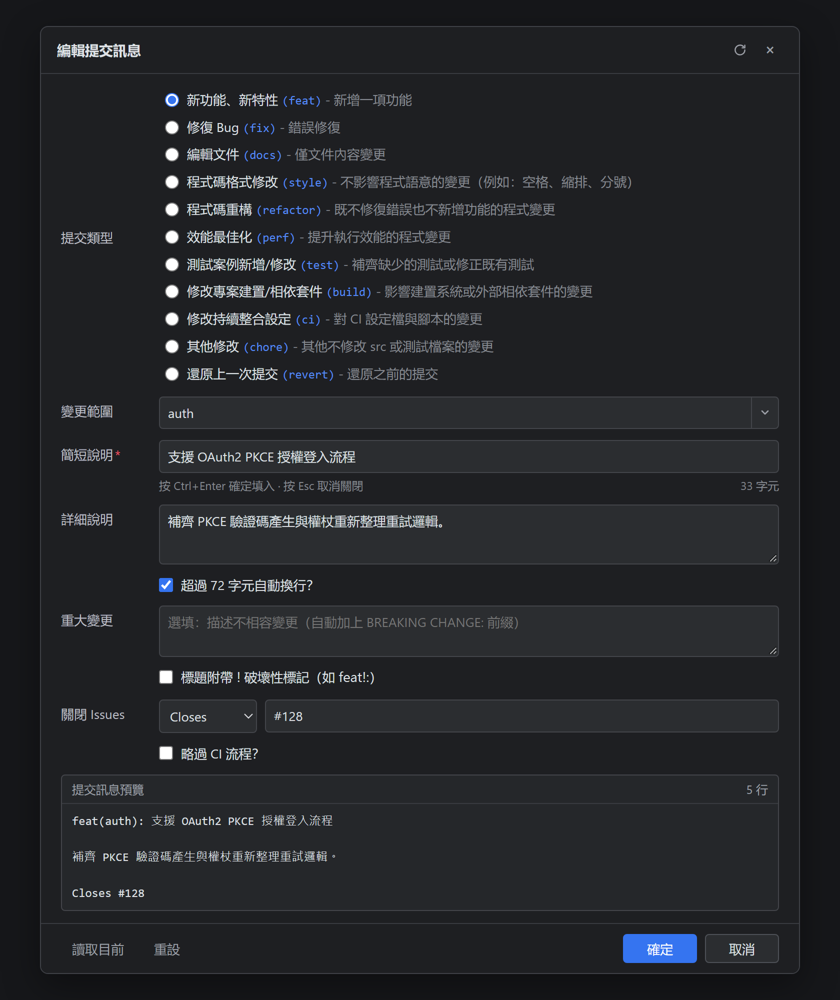

# Git Commit Template for OpenIDEA

[English](README.md) | [简体中文](README.zh-CN.md) | **繁體中文** | [日本語](README.ja.md)

面向 **OpenIDEA（`v0.1.53+`，Plugin API `^1.16`）** 的視覺化 **Conventional Commits** 提交訊息範本外掛。

掛載於 Git 提交（Commit）面板輸入框上方的工具列中，點擊圖示即可在主編輯區置中彈出**完整卡片式大表單**；填寫完成後點擊 **【確定】**（或按 `Ctrl+Enter` / `Cmd+Enter`），即可一鍵寫入 Commit 輸入框並**自動關閉表單頁**。

## 功能特色

- **畫面置中卡片式表單 + 自動關閉**：
  - 點擊 Commit 工具列圖示，或按下快速鍵 `Ctrl+Alt+Shift+C`（macOS：`Cmd+Alt+Shift+C`）即可開啟完整表單。
  - **【確定】 / `Ctrl+Enter`**：驗證並填入 Git 提交訊息輸入框，隨後自動關閉表單頁。
  - **【取消】 / 右上角 `×` / `Esc`**：不修改既有提交草稿，立即自動關閉表單頁。
- **完整 Conventional Commits 支援**：
  - 內建 11 種標準提交類型、最近 20 筆常用變更範圍記憶、標題字數提醒、72 字元自動換行、`BREAKING CHANGE:` 與標題 `!` 標記、`Closes / Fixes / Resolves` 關鍵字切換、`[skip ci]` 以及雙向回填解析。
- **提交前規範檢查（`commitChecks`）**：
  - 可於 Commit 選項（Before Commit）啟用 **Conventional Commits 規範檢查**，自動放行 `Merge` / `Revert` 等 Git 系統訊息。
- **多語言國際化（支援 11 種語言）**：
  - 自動跟隨 OpenIDEA 介面語言切換表單與提示文字。

## 權限與安全說明

本外掛運行於 WebAssembly 沙箱中，無網路、外部程序或專案檔案存取權限：
- `vcs.read` / `vcs.write`：讀取與回寫目前待提交的 Commit 訊息草稿。
- `storage`：儲存常用變更範圍與預設選項。
- `ide.commands`：**僅用於**點擊確定或取消後執行 `toolwindow.focusEditor` 與 `editor.closeTab` 自動關閉表單分頁。

## 授權條款

採用 [MIT License](LICENSE) 授權。
