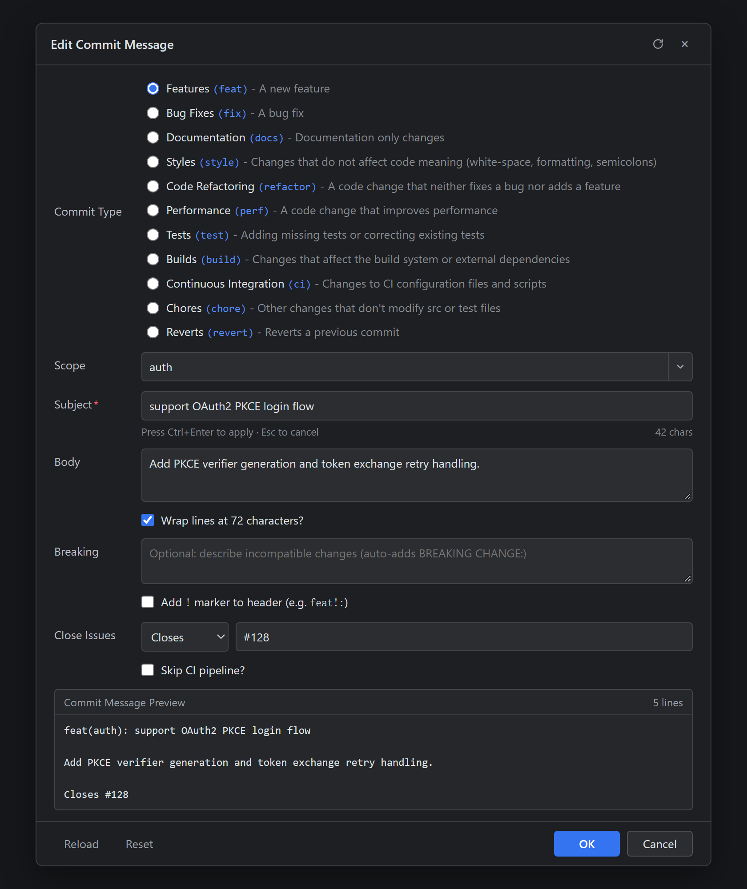
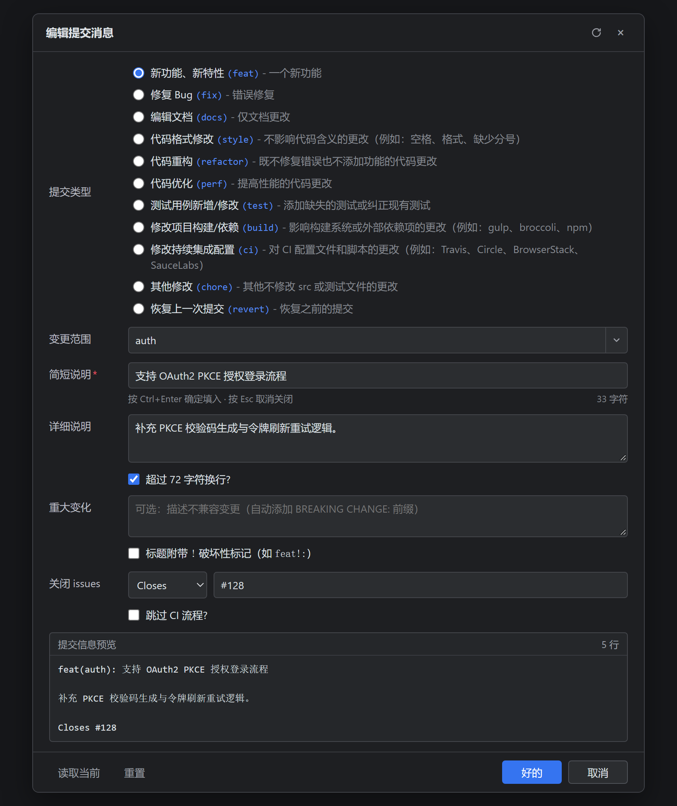

# OpenIDEA 官方提交 PR 素材与操作准备指南

本文档为你整理好了向 OpenIDEA 官方提交本插件所需的全部前置材料、签名命令与 PR 描述模板（目前**尚未发起任何 PR**，等你确认时机后直接按步骤执行即可）。

---

## 一、已完成的前置合规检查项

根据 OpenIDEA 官方文档（`plugins/README.md` 与 `l0ng-ai/openidea-plugins` 审核规范），维护者审核重点及本仓库准备情况如下：

1. **开源协议完备**：根目录已补齐标准 MIT [LICENSE](../LICENSE)，与 [plugin.toml](../plugin.toml) 中的 `license = "MIT"` 一致。
2. **发布者命名规范**：`plugin.toml` 中 `id` 已规范为 `chongchong59699.git-commit-template`（匹配你的 GitHub 账号前缀），并填写了 `authors` 与 `homepage`。
3. **零高风险权限（审核最友好）**：借助 OpenIDEA `v0.1.54`（API 1.18）原生 `[[contributes.dialogs]]`，插件已彻底移除 `ide.commands`，仅申请 `vcs.read`、`vcs.write`、`storage` 三项低风险权限，无网络、进程或文件越权风险。
4. **完整国际化（11 种语言）**：
   - 清单原文采用英文（符合官方 `pluginText.ts` 规范），`locales/` 内置 `zh-CN`、`zh-TW`、`ja`、`ko`、`fr`、`es-MX`、`pt-BR`、`pl`、`tr-TR`、`ru` 共 10 套翻译表。
   - Rust 后端与 `web/index.html` 全量支持 11 种语言动态切换。
5. **多语言实拍高清截图**：已生成并存放在 `docs/screenshots/`：
   - 英文：[docs/screenshots/en.png](screenshots/en.png)
   - 简体中文：[docs/screenshots/zh-CN.png](screenshots/zh-CN.png)
   - 繁体中文：[docs/screenshots/zh-TW.png](screenshots/zh-TW.png)
   - 日文：[docs/screenshots/ja.png](screenshots/ja.png)
   - 韩文：[docs/screenshots/ko.png](screenshots/ko.png)

---

## 二、路线一（推荐）：上架官方插件市场（提 PR 到 `l0ng-ai/openidea-plugins`）

OpenIDEA 官方将面向实际日常使用的插件统一收录在 **[l0ng-ai/openidea-plugins](https://github.com/l0ng-ai/openidea-plugins)**，合并后 1 小时内自动同步进所有 OpenIDEA 客户端内置的 **Settings → Plugins → Marketplace**。

### 第 1 步：生成你的发布者签名密钥（仅首次需要，私钥切勿提交到 Git！）

在安装有 `openidea-plugin` CLI 的环境中执行：

```bash
openidea-plugin keygen ~/chongchong59699.key
```

终端会打印出一行 Ed25519 公钥字符串（记下来，下一步填到 `publishers/chongchong59699.toml`），请妥善保管好私钥 `~/chongchong59699.key`（以后发新版本还要用同一把私钥签名）。

### 第 2 步：签名打包并发布本仓库 GitHub Release `v1.4.0`

```bash
openidea-plugin build .
openidea-plugin pack . --key ~/chongchong59699.key --publisher chongchong59699
shasum -a 256 chongchong59699.git-commit-template-1.4.0.oiplugin
```

在 `https://github.com/chongchong59699/openidea-git-commit-template/releases/new` 创建 Tag `v1.4.0`，把生成的 `chongchong59699.git-commit-template-1.4.0.oiplugin` 作为附件上传发布，并记录上面输出的 `sha256` 值。

### 第 3 步：Fork `l0ng-ai/openidea-plugins` 并新增两个文件

1. 新增 `publishers/chongchong59699.toml`：

```toml
name = "chongchong59699"
owners = ["chongchong59699"]
keys = ["qUdLq01QidzJMCM6lsQVd9MrFvKHZA+IJ+LiZc6+IJI="]
revoked-keys = []
```

2. 新增 `plugins/chongchong59699.git-commit-template.toml`：

```toml
repository = "https://github.com/chongchong59699/openidea-git-commit-template"

[[versions]]
version = "1.4.0"
package = "https://github.com/chongchong59699/openidea-git-commit-template/releases/download/v1.4.0/chongchong59699.git-commit-template-1.4.0.oiplugin"
sha256 = "<粘贴第 2 步计算出的 sha256>"
```

### 第 4 步：可直接复制的 PR 标题与正文模板

**PR Title:**
`Add chongchong59699.git-commit-template 1.4.0`

**PR Description:**
```markdown
## Summary

Adds **Git Commit Template** (`chongchong59699.git-commit-template` `v1.4.0`) and registers publisher `chongchong59699`.

- **Source repository**: https://github.com/chongchong59699/openidea-git-commit-template (MIT License)
- **Categories**: `vcs`, `tools`
- **Target API**: `^1.18` (built and verified with `openidea-plugin` v0.1.54)

## What It Does

Provides a visual **Conventional Commits** modal dialog (`[[contributes.dialogs]]`) mounted on the Git Commit message toolbar (`commit.message`), plus an optional before-commit format validator (`commitChecks`):
- Opens a native, resizable IDE modal dialog with 11 standard commit types, recent scope history, 72-char wrapping (Latin & CJK), breaking change `!` / footer support, `Closes` / `Fixes` / `Resolves` issue linking, `[skip ci]`, and two-way parsing of existing commit drafts.
- Automatically writes the formatted commit message and closes via `openidea.dialog.close()` on **OK** (`Ctrl+Enter`) or **Cancel** / `Esc`.
- Fully localized across **11 languages** (`en`, `zh-CN`, `zh-TW`, `ja`, `ko`, `fr`, `es-MX`, `pt-BR`, `pl`, `tr-TR`, `ru`).

## Capabilities

Only three low-risk capabilities are requested (zero high-risk capabilities):
- `vcs.read` / `vcs.write`: Reads the pending commit draft to pre-fill the form / run `commitChecks`, and writes the formatted message back to the Commit input box.
- `storage`: Persists recent commit scopes and default preferences locally.

## Screenshots

| English (`en`) | Simplified Chinese (`zh-CN`) |
| --- | --- |
|  |  |
```

---

## 三、路线二（备选）：提议作为官方内置插件合入 `l0ng-ai/openidea` 主仓

如果你想把它直接捐献进 `l0ng-ai/openidea` 仓库的 `plugins/official/git-commit-template/`：
1. 按照官方 `plugins/README.md` §8.1 规定：**新的 `openidea.*` 官方插件需先在 `l0ng-ai/openidea` 提一个 Issue 讨论**。
2. 获得维护者同意后，只需将 `plugin.toml` 的 `id` 改为 `"openidea.git-commit-template"`，并将编译产物 `dist/plugin.wasm` 一并放入 `plugins/official/git-commit-template/` 提交 PR 即可（官方主仓会使用官方密钥统一签名）。
